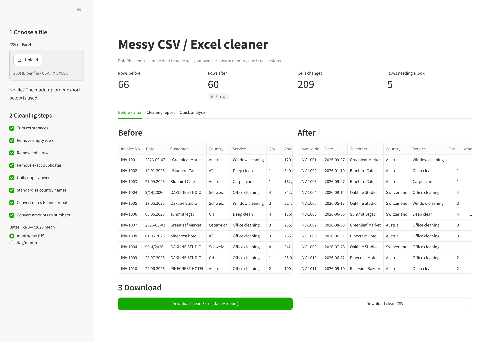

# Messy CSV / Excel cleaner (demo)

Upload a messy export and get a clean table, a before/after view and a log of every change. Missing values are flagged, never guessed.

**Try it in your browser:** https://dataphil.dev/demo/csv-cleaner/ (no install, first load takes 20–40 seconds; your file stays in your browser)



The included sample file (`data/sample_orders_messy.csv`) is a made-up order export with the usual problems:

| Problem | Example | Fix |
|---|---|---|
| Title rows above the header | `Order export ...`, `exported 2026-10-01` | header row detected automatically |
| Extra spaces | `  Bluebird Cafe ` | trimmed |
| Same name, different case | `OAKLINE STUDIO`, `oakline studio` | one spelling |
| Country spelled four ways | `AT`, `austria`, `Österreich` | `Austria` |
| Mixed date formats | `19.01.2026`, `9/14/2026`, `2026-09-07` | `2026-09-14` (ambiguous ones are counted) |
| Amounts as text | `€ 1.360,00`, `162,00`, `120.00 EUR` | `1360.0` |
| Duplicates, empty and total rows | | removed and counted |

The result can be downloaded as Excel (clean data + cleaning report) or CSV.

## Run it locally

Windows: double-click `start-windows.bat`
Mac / Linux: double-click `start-mac-linux.command` (Mac: right-click > Open the first time)

Or with Python 3.10+:

```bash
pip install -r requirements.txt
streamlit run app.py
```

## How it is built

`app.py` has three parts: reading (delimiter and header detection for CSV and Excel), cleaning (one small function per step, each step logs what it changed) and the Streamlit interface. In a client project the rules are adapted to their files and the script can run without the interface, for example every Monday on a shared folder.

`docs/index.html` is the browser version, built with [stlite](https://github.com/whitphx/stlite).

## About

Built by DataPhil: Excel and CSV work automated in Python, and data analysed with sound statistics. MIT licence.
